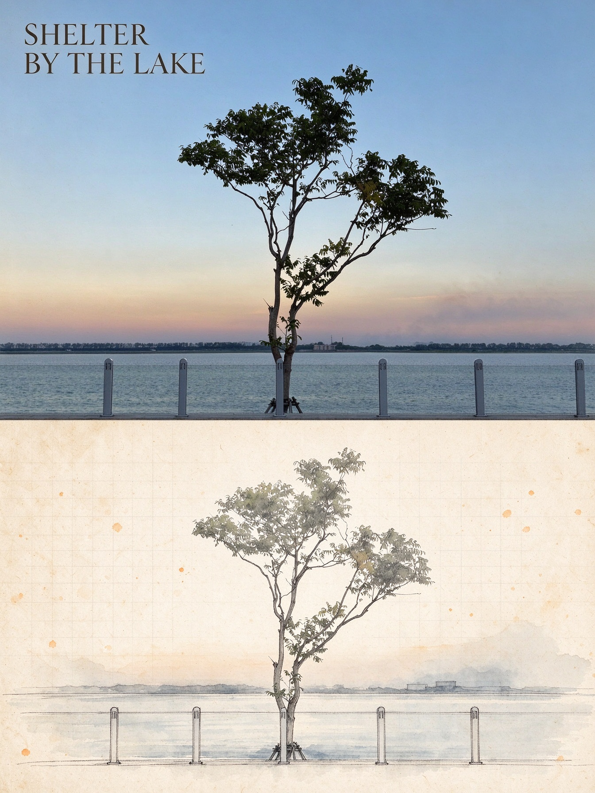

# 主体影像工坊

由 **AI十三** 维护的图片编辑 skill，用于把单张照片制作成保持原图尺寸、具有精品刊物气质的主体艺术海报。

画面上下严格按照 50:50 分配：上半保留原始摄影，只进行细腻调色与极轻微的胶片颗粒处理；下半在暖米色纸张上，通过拼贴、丝网印刷痕迹和设计草图重新演绎同一主体及其所在场景，并配置简洁的英文标题与年份。一次仅处理一张源照片，不生成多照片拼贴。

## 作者信息

- 作者：AI十三
- 邮箱：xiaowangboke@vip.qq.com

## 效果参考

以下图片仅用于说明成品的视觉方向，即摄影保真、同一主体重构，以及半透明色块、照片肌理与纤细绘图线的组合；样片内容不限定可处理的主体类型。

### 城市主体示例



## 安装与调用

将包含本文件的 skill 文件夹放入 Codex 可发现的 skills 目录，然后使用以下名称调用：

```text
$subject-editorial-poster
```

上传一张照片并提出制作主体艺术海报的需求即可。默认只输出一张完整成品，成品的宽度、高度、宽高比和方向均与原图一致。

## 文件说明

```text
subject-editorial-poster/
├── SKILL.md
├── README.md
├── agents/openai.yaml
└── assets/samples/
    └── city-subject-preview.jpg
```

参考样片只展示视觉风格，不作为额外输入或操作指令。
